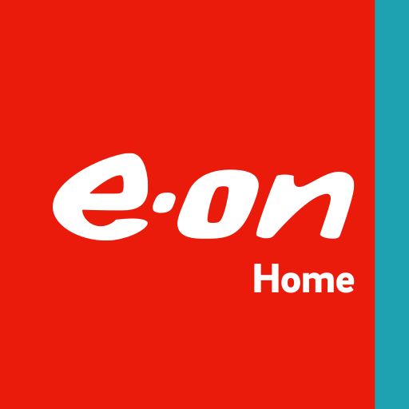

<p align="center">
  
</p>

<h1 align="center">E.ON Next Home</h1>
<h3 align="center">Home Assistant Integration</h3>

<p align="center">
  <a href="https://github.com/hacs/integration"></a>
  <a href="https://github.com/callumeveratt/ha-eon-next-home/releases"></a>
  <a href="https://github.com/callumeveratt/ha-eon-next-home/blob/master/LICENSE"></a>
  
</p>

---

> [!WARNING]
> This integration uses the **private E.ON Next / Kraken API**, reverse-engineered from the E.ON Next Home mobile app. It is not officially supported or endorsed by E.ON Next. It may break without warning if E.ON Next updates their app or API.

> [!NOTE]
> E.ON Next's smart charging backend is built on [Octopus Energy's Kraken platform](https://kraken.tech) — the same technology behind Intelligent Octopus Go. This integration covers **EV smart charging**, **smart meter usage and cost** for the Energy dashboard, and **tariff rates**.

---

## Features

### ⚡ Energy dashboard

If you have a smart meter, the integration imports your half-hourly electricity and gas usage, and what E.ON Next charged for it, into Home Assistant's long-term statistics. No extra hardware is needed.

E.ON Next only receives meter readings once a day, so the data is **1–2 days behind**. That's why it's imported as statistics against the half-hour it belongs to, rather than as a live sensor. On first setup it backfills everything back to when your E.ON Next supply started, which can take a minute. After that it checks for new readings every 2 hours, and re-imports the last 3 days each time so late or corrected readings are picked up.

To use it, go to **Settings → Dashboards → Energy**:

1. Under **Electricity grid → Add consumption**, choose **E.ON Next Electricity Consumption**. Under cost, pick **Use an entity tracking the total costs** and choose **E.ON Next Electricity Cost**
2. Under **Gas consumption**, choose **E.ON Next Gas Consumption** and **E.ON Next Gas Cost** the same way

Costs are E.ON Next's own half-hourly figures at your tariff's rates, VAT included. They don't include the standing charge. Recent days will be empty until E.ON Next receives the readings.

### 🔋 Sensors

| Entity | Description | Category |
|--------|-------------|----------|
| Smart Charge Status | Device registration status (`Live` / `Suspended`) | — |
| Vehicle | Your registered EV name (e.g. Audi Q4 e-tron) | Diagnostic |
| Smart Charge Window Start | Start time of the next planned charging window. Attributes `dispatches` (every planned slot: `start`, `end` in local ISO time, `kwh`, `source`, `location`, sorted by start) and `slot_count` | — |
| Smart Charge Window End | End time of the last planned charging window | — |
| Smart Charge Energy | Total kWh planned for the upcoming session | — |
| Smart Charge Slot Count | Number of planned charging slots (0 when none) | — |
| Battery Capacity | Vehicle battery size (kWh) | Diagnostic |
| Charger Max Power | Charger rated power (kW) | Diagnostic |
| Electricity Current Rate | Unit rate right now (GBP/kWh, inc. VAT). Attributes list the upcoming time-of-use windows | — |
| Electricity Standing Charge | Daily standing charge (GBP/day, inc. VAT) | — |
| Electricity Readings Up To | End of the latest half-hour E.ON Next has a reading for | Diagnostic |
| Gas Current Rate / Standing Charge / Readings Up To | As above, for gas (only if you have gas with E.ON Next) | — |

On time-of-use tariffs such as Next Drive, the current rate changes at the exact start and end of each window, including around the clocks changing. Day/night (Economy 7) tariffs aren't supported for rate sensors yet. Usage and cost import still works on those tariffs.

### 💡 Binary Sensors

| Entity | Description |
|--------|-------------|
| Charger Online | Whether the smart charger has an active connection to E.ON Next's servers |
| Smart Charging Scheduled | Whether dispatch windows are currently planned |
| Smart Charge Device Active | Whether the Kraken device is registered and live |
| Electricity Off-Peak | On during the tariff's cheapest window (e.g. 00:00–06:00 on Next Drive). Only created on time-of-use tariffs |

### 🔘 Switches

| Entity | Description |
|--------|-------------|
| Boost Charge | Start or cancel an immediate full-rate charge |

### 🔢 Numbers

| Entity | Description | Range | Category |
|--------|-------------|-------|----------|
| Target Charge | Target state of charge for autopilot charging | 10–100 % (step 5) | Config |

### 🕐 Times

| Entity | Description | Category |
|--------|-------------|----------|
| Ready By | Time the car should be fully charged by | Config |

---

## Installation

### Via HACS (Recommended)

1. Open **HACS** in Home Assistant
2. Go to **Integrations**
3. Click the **⋮** menu → **Custom repositories**
4. Enter this repository URL and set the category to **Integration**
5. Click **Add**, then find and click **Download** on the E.ON Next Home card
6. Restart Home Assistant

### Manual

1. Download this repository as a ZIP and extract it
2. Copy the `custom_components/eon_next_home/` folder into your HA config directory at `config/custom_components/eon_next_home/`
3. Restart Home Assistant

---

## Setup

1. Go to **Settings → Devices & Services → Add Integration**
2. Search for **E.ON Next Home**
3. Enter your E.ON Next account **API key** (starts with `sk_live_`)
4. Click **Submit** — the integration will authenticate and discover your account

> Your API key is stored locally in Home Assistant's config store and is only used to authenticate with the E.ON Next API.

### Getting your API key

In October 2026 E.ON Next moved sign-in to a new verification-code login and stopped accepting email and password from integrations. You now need an account API key. E.ON Next's website doesn't display it, so this repo includes a small script that reads it, or creates one, using your signed-in browser session:

1. Sign in at [eonnext.com](https://www.eonnext.com) and open your browser's developer tools (F12) on the **Network** tab
2. Click around your account until a request to `api.eonnext-kraken.energy/v1/graphql/` appears, and copy the value of its **Authorization** request header (it's valid for about an hour)
3. Run the script and paste the header when asked:

   ```bash
   python scripts/get_api_key.py
   ```

4. Copy the `sk_live_…` key it prints into Home Assistant

An account has **one** live API key. If you already use one elsewhere (e.g. Predbat or EnergyDock), use that same key. Creating a new one stops the old key working everywhere.

### Upgrading from 1.1.4 or earlier

After updating, Home Assistant will show a **Re-authenticate** card for E.ON Next Home under **Settings → Devices & Services**. Enter your API key there. Your entities and history are kept, and the old saved email and password are removed.

---

## Requirements

- An E.ON Next account
- For EV features: an EV registered for smart charging, with a compatible smart charger connected to the E.ON Next Home app (e.g. Ohme Home Pro)
- For the Energy dashboard: a smart meter sending half-hourly readings
- Home Assistant **2025.11** or newer (needed for the long-term statistics import)

---

## How it works

- All reads and writes use the **Kraken GraphQL API** (`api.eonnext-kraken.energy`) — the same endpoint E.ON Next's app backend is built on
- EV data is polled on a configurable interval (default **5 minutes**, minimum 2 minutes). Tariffs are refreshed hourly and meter readings every 2 hours
- The scan interval can be changed at any time via the **Configure** button on the integration card in **Settings → Devices & Services**
- ⚠️ Setting the interval too low may cause E.ON Next to rate-limit or block your account — 5 minutes is the recommended minimum
- Setting the **Target Charge** or **Ready By** entities writes back to the API immediately via the `setVehicleChargePreferences` mutation
- Authentication exchanges your API key for short-lived Kraken access tokens (≈1 hour), which are renewed automatically
- If E.ON Next rejects the API key (e.g. it was replaced by generating a new one), Home Assistant will prompt you to enter the new key
- All API calls are made over HTTPS

---

## Contributions

Pull requests are welcome. If you find a bug or want to request a feature (e.g. solar or export), please open an [issue](https://github.com/callumeveratt/ha-eon-next-home/issues).

---

## Disclaimer

This project is not affiliated with, endorsed by, or officially connected to E.ON Next or Octopus Energy. Use at your own risk.
